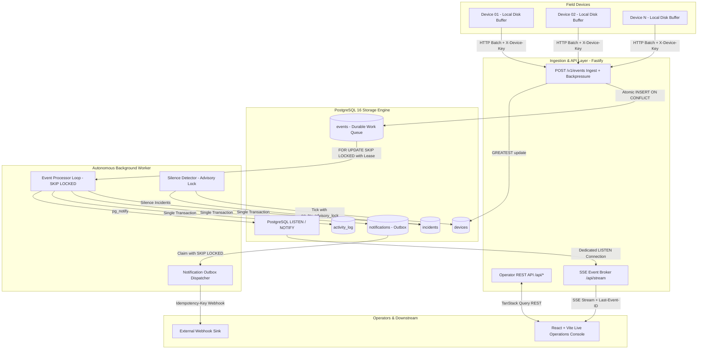

# Architecture Notes: Decisions, Alternatives & Trade-offs

> **Platform**: RTOps — Real-Time Operations Platform  
> **Repository**: [Pranav140/Appscrip-assesment](https://github.com/Pranav140/Appscrip-assesment.git)  
> **Evaluation Focus**: Reliability, Concurrency, Fault Tolerance, Real-Time Streaming & Engineering Judgment

---

## 1. Executive Summary & Problem Interpretation

The objective is to build a real-time fleet operations platform monitoring geographically distributed devices. In real-world IoT and industrial operations, edge environments are notoriously hostile:
- Networks disconnect unexpectedly and reconnect in bursts.
- Devices deliver out-of-order, replayed, or duplicate events.
- Device hardware clocks drift or report wildly inaccurate timestamps.
- Downstream notification endpoints suffer intermittent outages.
- Surges in telemetry threaten to saturate database write throughput.

Rather than building an over-engineered, fragile microservices web with multiple distributed data stores (Kafka, Redis, Mongo, RabbitMQ), this platform prioritizes **provable correctness, atomic consistency, and defendable engineering decisions**.

---

## 2. High-Level System Topology



---

## 3. Core Architectural Decisions, Alternatives & Trade-offs

| Concern | Architectural Choice | Why This Choice | Alternatives Considered | Trade-off / Downside |
|---|---|---|---|---|
| **Database & Queue** | **PostgreSQL 16** with `FOR UPDATE SKIP LOCKED` | Allows event processing, incident creation, and notification outbox enqueue to execute in the **exact same ACID transaction**. Zero distributed transactions; zero dual-write bugs. | **Kafka / RabbitMQ / Redis Streams** | Throughput ceiling bounded by PostgreSQL write IOPS (~5,000–10,000 writes/sec). Documented migration threshold for scale. |
| **Ingestion Protocol** | **HTTP `POST /v1/events` (Batches up to 500)** | Stateless, horizontally scalable behind L4/L7 load balancers, per-event acknowledgement, perfect for disk-buffered reconnect replay. | **MQTT / WebSockets** | MQTT is ideal for low-power edge telemetry; documented as the production edge gateway upgrade. |
| **Real-Time Channel** | **Server-Sent Events (SSE)** + REST catch-up | Unidirectional server-to-browser streaming fits the operations console. Built-in browser reconnection and `Last-Event-ID` cursor recovery. | **WebSockets** | WebSockets add stateful connection tracking and proxy renegotiation overhead without bidirectional need. |
| **Notifications** | **Transactional Outbox Pattern** | Enqueuing notifications within the incident transaction guarantees zero lost alerts even if external webhooks are dead. | **Inline Webhook Calls** | Inline calls block worker threads, add latency spikes, and drop alerts during downstream outages. |
| **Deduplication** | **Database-Level Unique Constraints** | Guarantees idempotency at the storage boundary; concurrency cannot bypass a database unique index. | **In-Memory Cache / Redis TTL** | Memory deduplication is lost on restarts; Redis adds distributed race windows. |
| **API Framework** | **Fastify + Zod** | High throughput, schema compilation, native Pino structured logging, robust request lifecycle hooks. | **Express / NestJS** | Express has higher overhead and weaker typing; NestJS introduces excessive abstraction. |
| **Frontend** | **React + Vite + TanStack Query** | Declarative state management, optimistic updates, automatic cache invalidation on SSE reconnect. | **Next.js** | Server-side rendering (SSR) is unnecessary for an authenticated, behind-the-login operations tool. |

---

## 4. Delivery Guarantees & Concurrency Architecture

### 4.1 End-to-End Delivery Matrix

| Hop | Guarantee | Underlying Mechanism |
|---|---|---|
| **Device → Platform** | **At-least-once** | Devices buffer telemetry on local disk (`.jsonl`). An event is only removed from the buffer after the server returns `status: "accepted"`, `"duplicate"`, or `"rejected"`. |
| **Ingest → Storage** | **Accepted means durable** | The API only returns `200 OK` after the PostgreSQL transaction commits. `UNIQUE (device_id, event_id)` makes duplicate replays harmless. |
| **Storage → Worker** | **At-least-once, effectively-once effects** | Worker claims batches with a 30-second lease (`locked_until`). Processing, incident creation, and marking `done` happen in **one atomic transaction**. A crash rolls back the whole unit; the expired lease is re-claimed by another worker. |
| **Worker → Notification** | **At-least-once, receiver deduplicated** | Transactional outbox with exponential backoff and circuit breaking. Webhook requests include a deterministic `Idempotency-Key: incident:{id}:operator:{id}:opened` header. |
| **Ordering Assumption** | **No global clock ordering assumed** | Rule evaluation is order-insensitive. Device online status uses monotonic server receive time: `GREATEST(last_seen_at, now())`. |
| **Platform Overload** | **Honest backpressure** | When queue depth exceeds the watermark (5,000 pending), Ingest returns `HTTP 429 Too Many Requests` + `Retry-After: 5`. Devices buffer on disk; zero silent drops. |

---

## 5. Concurrency & Integrity Invariants

### 1. Zero Duplicate Incidents Under Concurrency
A common flaw in operations platforms is generating multiple duplicate incidents when bursts of abnormal readings arrive simultaneously. RTOps enforces:
```sql
CREATE UNIQUE INDEX uq_incident_dedupe_active
  ON incidents(dedupe_key)
  WHERE state IN ('open', 'acknowledged');
```
Where `dedupe_key = 'rule:{rule_id}:device:{device_id}'`.
- When 500 matching temperature events arrive across concurrent workers, the first inserts the incident; the remaining 499 hit the unique index and atomically execute:
  ```sql
  DO UPDATE SET occurrence_count = occurrence_count + 1, last_seen_at = EXCLUDED.last_seen_at
  ```
- Because it is a **partial unique index**, once an operator marks the incident `resolved`, a future violation after the cooldown period safely opens a new incident row.

### 2. Single-Leader Scheduler Without Zookeeper
To prevent multiple worker instances from running concurrent silence detection ticks and thrashing the database:
```sql
SELECT pg_try_advisory_lock(987654321) AS acquired;
```
Only one worker acquires the lock. If that worker process crashes, PostgreSQL automatically releases the advisory lock with the TCP connection, and another worker claims it on the subsequent tick.

### 3. Startup Grace Period
Immediately following platform reboot or deployment, data absence is ambiguous (the platform was offline, not necessarily the field devices). The silence detector implements a **60-second Startup Grace Period** during which silence rules are suppressed, preventing false-positive alert floods.

---

## 6. Real-Time Streaming & Client Resilience

1. **In-Memory SSE Fan-Out**: The Fastify API maintains an in-memory broker connected to PostgreSQL via a dedicated `LISTEN` connection (`events_ingested`, `incident_changed`, `device_status_changed`, `activity`).
2. **Bounded Client Queues**: Slow clients have their event messages throttled with dropped-message counters, while critical `incident` and `device` state changes are **never dropped**.
3. **Reconnect & Catch-Up**:
   - Every SSE message includes an activity sequence `id:`.
   - On reconnect, browser sends `Last-Event-ID`.
   - If the gap is small (<1,000 items), the server replays missed events.
   - If the gap is large, the server issues a `resync` command, causing TanStack Query to refetch fresh snapshots via REST.
4. **Offline UI State Preservation**: When the browser drops connection, a sticky top banner warns:
   `⚠️ Connection lost. Showing cached state from 14:22:05. Reconnecting...`
   Mutation buttons (Acknowledge / Resolve) are disabled with clear tooltips preventing phantom actions.

---

## 7. Scaling Roadmap (Beyond 10,000 Events/Sec)

When fleet size expands beyond 25,000 high-frequency devices, the PostgreSQL ingestion queue reaches its disk IOPS ceiling. The modular architecture enables an incremental migration:

```
[ Current (< 10k ev/s) ]
Device HTTP Batch ──> Fastify Ingest ──> PostgreSQL (SKIP LOCKED) ──> Worker

[ Scale (> 50k ev/s) ]
Device (MQTT / mTLS) ──> EMQX / AWS IoT Core ──> Apache Kafka ──> Worker Pool ──> Hot Incidents (PostgreSQL) + Cold Analytics (ClickHouse)
```

1. **Edge Protocol**: Introduce an MQTT broker (EMQX or AWS IoT Core) terminating mTLS at the edge.
2. **Buffer Swap**: Replace the PostgreSQL `events` queue with Apache Kafka partitioned by `device_id`. Because the `EventProcessor` loop isolates ingestion from processing, the database becomes a pure state store.
3. **Partitioning**: Partition the PostgreSQL `events` table by weekly range on `received_at`, dropping historic partitions or archiving to Amazon S3 Parquet.
