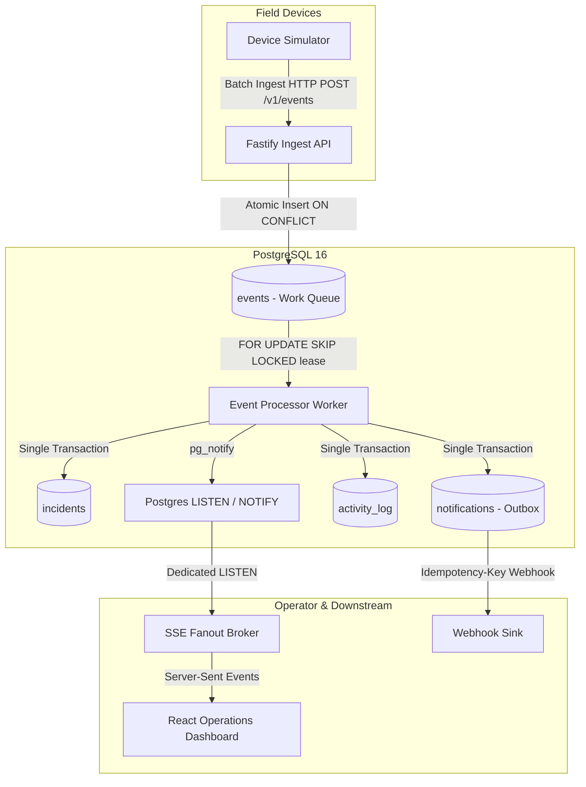

# RTOps — Real-Time Operations Platform

A resilient, production-grade real-time operations platform for managing fleet telemetry, automated alert rules, deduplicated incidents, and live operational monitoring under extreme network and system faults.

---

## 🌟 Key Features & Reliability Guarantees

- **Accepted Means Durable**: Events are acknowledged only after database commit. `UNIQUE (device_id, event_id)` guarantees idempotent deduplication under retries and network replays.
- **Durable Queue in PostgreSQL**: Claiming uses `FOR UPDATE SKIP LOCKED` with timed leases. Crashed or killed workers trigger zero data loss; leases expire and work is reclaimed automatically.
- **Incident Deduplication & Cooldown**: Incident dedupe key (`rule_id + device_id`) backed by a partial unique index guarantees at most one open/acknowledged incident per alarm condition.
- **Transactional Outbox & Circuit Breaker**: Webhook notifications are enqueued within the incident transaction and dispatched by an outbox worker with exponential backoff, jitter, and destination circuit breaking.
- **Honest Backpressure**: Ingest API rejects traffic with `HTTP 429 Too Many Requests` + `Retry-After: 5` when queue depth exceeds the watermark, prompting devices to buffer durably on disk.
- **Resilient Real-Time Dashboard**: Server-Sent Events (SSE) with `Last-Event-ID` cursor recovery and persistent offline warning banners when disconnected.

---

## 🏗️ Architecture Overview



---

## 🚀 3-Command Quickstart

### 1. Boot Infrastructure & Seed
```bash
# Start Postgres & Webhook Sink
docker compose up -d postgres webhook-sink

# Apply migrations and seed demo data
npm run db:reset && npm run db:migrate && npm run seed
```

### 2. Start Services
```bash
# Terminal 1: API Server (Port 3000)
npm run dev:api

# Terminal 2: Background Worker (Port 3002)
npm run dev:worker

# Terminal 3: Web Dashboard (Port 5173)
npm run dev:web
```

### 3. Open Dashboard & Run Device Traffic
- Open **http://localhost:5173** in your browser.
- In a fourth terminal, start realistic fleet telemetry:
```bash
npm run scenario:normal
```

---

## 🧪 Simulator Edge-Case & Chaos Scenarios

The simulator CLI tests real-world edge cases on demand:

| Command | Scenario Simulated | Expected Outcome |
|---|---|---|
| `npm run scenario:normal` | Steady fleet traffic from 5 devices | Live Events feed updates, queue depth ~0 |
| `npm run scenario:offline` | Device goes offline 60s, buffers, replays | Device marked stale/offline; silence incident opens, then auto-resolves on replay |
| `npm run scenario:duplicates` | Re-sends identical batches multiple times | Server responds `status: "duplicate"`, 0 extra rows inserted |
| `npm run scenario:out-of-order` | Shuffled and historic timestamps | Monotonic `GREATEST` prevents last_seen_at rollback |
| `npm run scenario:burst` | 5,000 rapid telemetry events | Backpressure handles burst with zero event loss |
| `npm run scenario:malformed` | Bad JSON, missing fields, future timestamps | Invalid events rejected into `rejected_events`; valid events accepted |
| `npm run scenario:abnormal` | Temperature spike (>95°C) | Single high-temperature incident opens with incremented match count |

---

## 🔍 Zero-Loss Mathematical Audit

Verify system consistency and zero data loss after running tests:
```bash
npm run reconcile
```
Expected output:
```
================ SIMULATOR RUN SUMMARY ================
  AUDIT RESULT: [ PASS ] Zero data loss, zero duplication.
=======================================================
```

---

## 📚 Technical Documentation Index

- **[Architecture Decision Records (ADRs)](docs/DECISIONS.md)**: Rationale for PostgreSQL queue, SSE, untrusted clocks, and outbox.
- **[System Architecture](docs/ARCHITECTURE.md)**: Sequence diagrams for normal flow, reconnect replay, and crash recovery.
- **[Database Schema & Constraints](docs/SCHEMA.md)**: Deep dive into uniqueness indexes and concurrency protection.
- **[Device Protocol](docs/PROTOCOL.md)**: Wire protocol, batch schemas, and retry semantics.
- **[Reliability Failure Matrix](docs/RELIABILITY.md)**: "What happens when X fails?" coverage table.
- **[Production Deployment & Scaling](docs/DEPLOYMENT.md)**: ECS/EKS topology, Kafka migration path, and alert rules.
- **[10-Minute Demo Script](docs/DEMO.md)**: Step-by-step evaluator presentation guide.
- **[Viva & Interview Preparation](docs/VIVA_NOTES.md)**: 15 crisp architectural questions and answers.
- **[Platform Limitations](docs/LIMITATIONS.md)**: Honest disclosure of trade-offs and future work.
