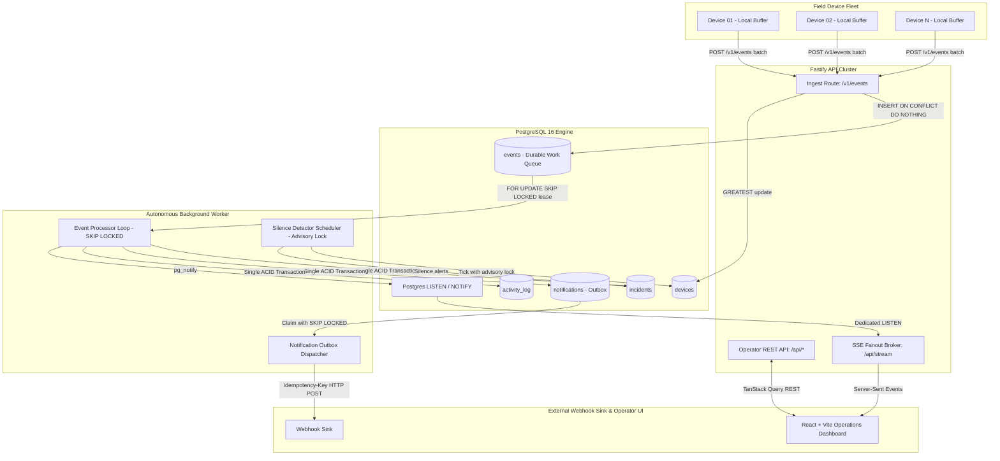
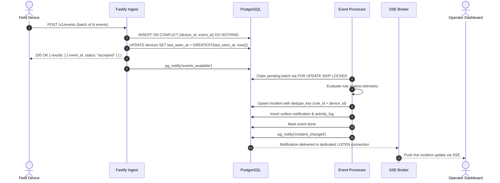
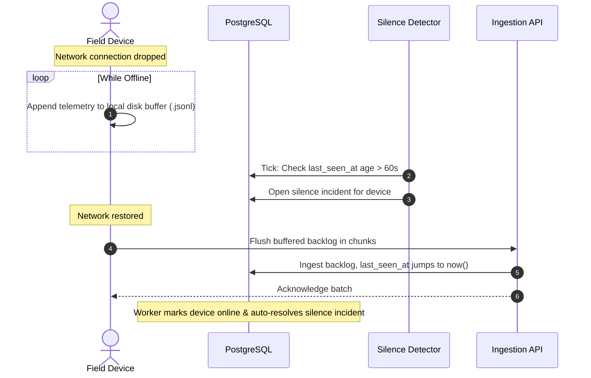
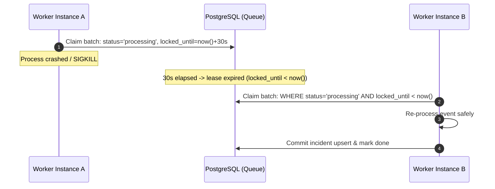

# System Architecture & Technical Specification

## High-Level Topology

## Core Sequence Workflows

### 1. Ingest → Event Processor → Incident → SSE Stream

### 2. Device Offline → Reconnect Replay

### 3. Worker Crash Recovery

